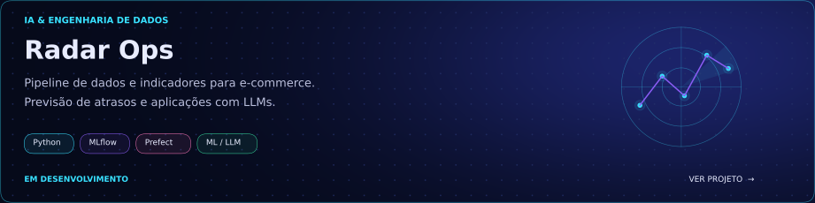
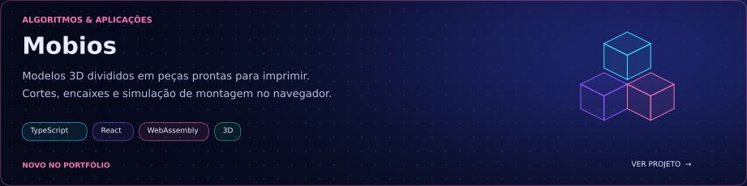
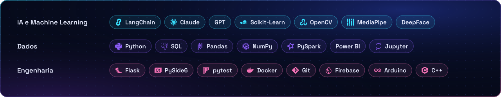

  

Sou **Éverton Costa da Silva**, Engenheiro de Computação pela **FIAP**, com **MBA em Data Science & Inteligência Artificial**. Meu foco está em **IA aplicada, ciência de dados e automação com Python**.

Construo soluções com **LLMs e agentes**, **Machine Learning** e **visão computacional**, conectando modelos, dados e aplicações. Trabalho no Laboratório Maker da FIAP e uso a engenharia como base para transformar problemas reais em soluções práticas.

### IA & Dados

- **LLMs e agentes:** aplicações com GPT, Claude e LangChain.
- **Ciência de dados:** análise e preparação de dados com Python, SQL, Pandas, NumPy e PySpark; visualização com Power BI.
- **Machine Learning e visão computacional:** Scikit-learn, OpenCV, MediaPipe e DeepFace.
- **Automação:** integração de ferramentas e simplificação de processos com Python.

### Projetos em destaque

  
  

  

### Automação & Otimização

### Novos projetos

### Ferramentas

### Vamos conversar

Para trocar ideias ou colaborar em projetos de **inteligência artificial, dados e automação**:

