  

Sou Engenheiro de Computação pela FIAP, com MBA em Data Science & Inteligência Artificial. Construo soluções com LLMs e agentes (GPT, Claude, LangChain), visão computacional e Machine Learning, e uso Python para automatizar o que ainda é feito à mão. Hoje trabalho no Laboratório Maker da FIAP.

### Projetos

  
  

  
  

### Ferramentas

### Contato

